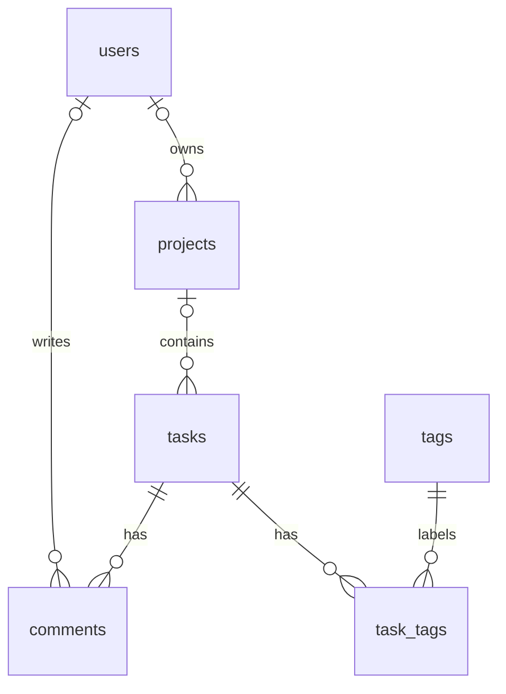

# SQLite Project Lab — Presentation

เนื้อหานำเสนอ 14 สไลด์ ใช้เวลาประมาณ 14–18 นาที พร้อมบทพูดและขั้นตอนสาธิตที่ตรงกับโปรเจกต์จริง

## สไลด์ 1: ชื่อโครงการ

**ระบบจัดการโปรเจกต์ด้วย Node.js และ SQLite**

- จัดการผู้ใช้ โปรเจกต์ งาน ความคิดเห็น และแท็ก
- ใช้ฐานข้อมูลสัมพันธ์ 6 ตาราง
- เรียนรู้ CRUD, JOIN, Foreign key และ Transaction

บทพูด: “ระบบนี้แสดงการทำงานตั้งแต่หน้าเว็บเรียก API ไปจนถึง Node.js อ่านและเขียน SQLite โดยข้อมูลแต่ละประเภทมีความสัมพันธ์กัน”

## สไลด์ 2: วัตถุประสงค์

- ออกแบบข้อมูลให้เป็นตารางที่สัมพันธ์กัน
- นำเข้า schema และข้อมูลตัวอย่างจาก SQL
- พัฒนา API และหน้าเว็บที่ใช้ข้อมูลครบทั้ง 6 ตาราง
- ตรวจความถูกต้องของข้อมูลและผลของการลบข้อมูลสัมพันธ์

บทพูด: “ผู้ใช้เป็นเจ้าของโปรเจกต์ โปรเจกต์มีงาน งานมีความคิดเห็นและแท็ก เราจึงฝึกทั้ง CRUD และการเชื่อมข้อมูลหลายตาราง”

## สไลด์ 3: SQLite คืออะไร?

**SQLite คือระบบฐานข้อมูลเชิงสัมพันธ์ที่ฝังอยู่ในโปรแกรม และใช้ภาษา SQL จัดการข้อมูล**

- เก็บข้อมูลเป็นตาราง แถว และคอลัมน์ พร้อมเชื่อมความสัมพันธ์ระหว่างตาราง
- โปรแกรมเรียกไลบรารี SQLite เพื่ออ่าน/เขียนไฟล์โดยตรง ไม่ต้องมี process ของ database server แยก
- ฐานข้อมูลหลักเก็บในไฟล์เดียว เช่น `data/todo.db`; ขณะใช้งานอาจมีไฟล์ journal หรือ WAL เพิ่มเติม
- รองรับ SELECT, INSERT, UPDATE, DELETE, JOIN และ Transaction
- SQL คือภาษา ส่วน SQLite คือระบบฐานข้อมูลที่ใช้ภาษานั้น

บทพูด: “SQLite ทำให้โปรแกรมเก็บข้อมูลแบบฐานข้อมูลได้โดยไม่ต้องติดตั้งบริการฐานข้อมูลแยก ในงานนี้ Node.js เรียก SQLite และข้อมูลอยู่ใน todo.db คำว่า serverless ของ SQLite หมายถึงไม่มี database server แยก แต่เว็บของเรายังมี Node.js server รับ request อยู่”

อ้างอิง: [SQLite คืออะไรและเก็บข้อมูลอย่างไร](https://www.sqlite.org/about.html)

## สไลด์ 4: ข้อดีของ SQLite

| ข้อดี                                    | ประโยชน์กับโครงการนี้                                    |
| ---------------------------------------- | -------------------------------------------------------- |
| เริ่มใช้งานง่าย ตั้งค่าน้อย              | เปิดไฟล์ฐานข้อมูลแล้วทดลอง SQL ได้                       |
| ไม่ต้องดูแล database server แยก          | ใช้งานในเครื่องเรียนหรือสาธิตได้สะดวก                    |
| ฐานข้อมูลหลักเป็นไฟล์เดียว               | เปิดดูด้วยเครื่องมือ SQLite และย้ายข้อมูลได้ง่าย         |
| มี SQL และ Transaction แบบ ACID          | ฝึก JOIN และบันทึกชุดแท็กให้สำเร็จครบหรือย้อนกลับทั้งหมด |
| ตัวระบบขนาดเล็กและโค้ดเป็น public domain | ใช้กับงานส่วนตัวและเชิงพาณิชย์ได้                        |

บทพูด: “ข้อดีที่เห็นชัดในโปรเจกต์นี้คือเริ่มใช้งานง่าย แต่ยังได้เรียนรู้ความสามารถของฐานข้อมูลสัมพันธ์ เช่น JOIN และ transaction ถ้าบันทึกแท็กผิดพลาด ระบบย้อนกลับได้แทนที่จะเหลือข้อมูลบางส่วน”

หมายเหตุ: เมื่อต้องสำรองฐานข้อมูลที่กำลังใช้งาน ให้ใช้กลไก backup ของ SQLite หรือปิด connection ให้เรียบร้อยก่อนคัดลอก โดยเฉพาะเมื่อมี WAL ไม่ควรคัดลอกเฉพาะไฟล์ .db ระหว่างมีการเขียน

อ้างอิง: [คุณสมบัติ SQLite](https://www.sqlite.org/about.html), [การสำรองข้อมูล SQLite](https://www.sqlite.org/backup.html)

## สไลด์ 5: ข้อเสียและข้อจำกัดของ SQLite

| ข้อจำกัด                                                 | ผลต่อการออกแบบระบบ                                                       |
| -------------------------------------------------------- | ------------------------------------------------------------------------ |
| เขียนได้ครั้งละหนึ่ง transaction ต่อไฟล์ฐานข้อมูล        | งานที่มีการเขียนพร้อมกันมากอาจต้องรอหรือพบ database locked               |
| ไม่มีบริการเชื่อมต่อฐานข้อมูลผ่านเครือข่ายในตัว          | ถ้าหลายเครื่องต้องใช้งาน ให้ผ่าน API หรือเลือกฐานข้อมูลแบบ client/server |
| ไม่มีระบบบัญชีผู้ใช้และ GRANT/REVOKE แบบฐานข้อมูล server | แอปต้องจัดการ login และสิทธิ์เอง รวมถึงสิทธิ์เข้าถึงไฟล์                 |
| ไม่เหมาะกับการแชร์ไฟล์ฐานข้อมูลผ่าน network filesystem   | การล็อกไฟล์และความหน่วงอาจมีปัญหา ควรให้ server เปิดไฟล์ในเครื่องของตน   |

บทพูด: “SQLite รองรับหลายผู้อ่าน แต่ผู้เขียนในไฟล์เดียวกันยังต้องทำทีละ transaction ถ้างานมีการเขียนพร้อมกันจำนวนมาก หรือหลาย server ต้องใช้ฐานข้อมูลกลาง ควรประเมิน PostgreSQL หรือ MySQL ข้อจำกัดขึ้นกับลักษณะงาน ไม่ใช่แค่จำนวนตาราง”

แยกจากข้อจำกัด SQLite: `DatabaseSync` ที่โปรเจกต์นี้เลือกใช้เป็น API แบบ synchronous ของ Node.js จึงบล็อก event loop ขณะรันคำสั่ง ส่วนการไม่มี login เป็นขอบเขตของโปรเจกต์นี้

อ้างอิง: [งานที่เหมาะและไม่เหมาะกับ SQLite](https://www.sqlite.org/whentouse.html), [การเขียนพร้อมกันและ WAL](https://www.sqlite.org/wal.html), [ฟีเจอร์ SQL ที่ SQLite ไม่รองรับ](https://www.sqlite.org/omitted.html)

## สไลด์ 6: ควรใช้ SQLite กับงานแบบไหน?

| ลักษณะงาน                                                 | แนวทางเลือก                                           |
| --------------------------------------------------------- | ----------------------------------------------------- |
| เรียน SQL ทำต้นแบบ และสาธิต                               | SQLite เริ่มง่ายและแชร์ไฟล์ให้ผู้เรียนได้             |
| แอปมือถือ เดสก์ท็อป หรืออุปกรณ์ที่เก็บข้อมูลในเครื่อง     | SQLite เหมาะกับการฝังในแอป                            |
| เว็บไซต์ที่ภาระการเขียนไม่สูงและฐานข้อมูลอยู่เครื่องเดียว | SQLite เป็นทางเลือกได้ โดยทดสอบภาระงานจริง            |
| หลาย server เขียนข้อมูลกลางพร้อมกันมาก                    | พิจารณา PostgreSQL/MySQL และสถาปัตยกรรม client/server |

**เหตุผลที่เลือกใน Project Lab:** เป็นงานเรียนรู้ในเครื่อง ใช้ 6 ตาราง ฝึก CRUD, JOIN และความสัมพันธ์ได้ครบ โดยไม่ต้องดูแลบริการฐานข้อมูลเพิ่มเติม

บทพูด: “สำหรับโครงการนี้ SQLite ตรงกับเป้าหมาย เพราะช่วยให้เราเน้นการออกแบบข้อมูลและเขียน SQL ได้ทันที เมื่อขยายงาน ให้ดูจำนวนการเขียนพร้อมกัน การกระจาย server และความต้องการสิทธิ์ก่อนเลือกฐานข้อมูล”

อ้างอิง: [แนวทางเลือกใช้งานจาก SQLite](https://www.sqlite.org/whentouse.html)

## สไลด์ 7: เครื่องมือและเส้นทางข้อมูล

```text
React / CSS / Lucide React
       ↓ fetch + JSON
Node.js 24 HTTP server
       ↓ node:sqlite / prepared statements
SQLite: data/todo.db
```

- Node.js 24 ขึ้นไป; ทดสอบในเครื่องด้วย 24.14.0
- ไม่ต้องเปิด database server แยก
- ฐานข้อมูลจริง: C:\Users\winne\Desktop\Web\SQLite\data\todo.db
- sql/import.sql คือคำสั่ง SQL สำหรับ import

บทพูด: “หน้าเว็บไม่ได้เปิดไฟล์ฐานข้อมูลโดยตรง แต่เรียก API ให้ Node.js จัดการข้อมูล SQLite เก็บข้อมูลไว้ในไฟล์และยังอยู่หลังปิดโปรแกรม”

## สไลด์ 8: ตารางทั้ง 6

| ตาราง     | ข้อมูล          | ความสัมพันธ์                       |
| --------- | --------------- | ---------------------------------- |
| users     | ชื่อและ email   | email ไม่ซ้ำ                       |
| projects  | ชื่อโปรเจกต์    | owner_id → users                   |
| tasks     | ชื่อ สถานะ เวลา | project_id → projects              |
| comments  | ข้อความ เวลา    | task_id → tasks, author_id → users |
| tags      | ชื่อแท็ก        | ชื่อไม่ซ้ำ                         |
| task_tags | คู่งานและแท็ก   | task_id → tasks, tag_id → tags     |

บทพูด: “ตาราง task_tags เป็นตารางเชื่อม จึงไม่มี id แยก แต่ใช้รหัสงานกับรหัสแท็กเป็น primary key ร่วมกัน ทำให้งานเดียวกันไม่ติดแท็กเดิมซ้ำ”

## สไลด์ 9: ความสัมพันธ์และการลบ



- One-to-many: โปรเจกต์หนึ่งมีหลายงาน งานหนึ่งมีหลายความคิดเห็น
- Many-to-many: งานมีหลายแท็ก แท็กใช้กับหลายงาน
- CASCADE: ลบงานแล้วลบความคิดเห็นและคู่แท็ก; ลบแท็กแล้วลบคู่แท็ก
- SET NULL: ลบผู้ใช้แล้วไม่ระบุเจ้าของ/ผู้เขียน; ลบโปรเจกต์แล้วงานไม่ระบุโปรเจกต์
- เปิด PRAGMA foreign_keys = ON ใน connection

บทพูด: “Foreign key ป้องกันการอ้างรหัสที่ไม่มีจริง และกำหนดผลของการลบไว้ชัดเจน หน้าเว็บแสดงข้อความผลกระทบก่อนให้ยืนยันการลบ”

## สไลด์ 10: หน้าจอและ API

| หน้าจอ        | การใช้งาน                                     | API                     |
| ------------- | --------------------------------------------- | ----------------------- |
| ผู้ใช้        | เพิ่ม แก้ไข ลบชื่อและ email                   | /api/users              |
| โปรเจกต์      | เพิ่ม แก้ไข ลบ เลือกเจ้าของ                   | /api/projects           |
| งาน           | เพิ่ม แก้ไข ลบชื่อ เลือกโปรเจกต์ เปลี่ยนสถานะ | /api/tasks              |
| แท็ก          | เพิ่ม แก้ไข ลบ                                | /api/tags               |
| รายละเอียดงาน | เพิ่ม แก้ไข ลบความคิดเห็น เลือกผู้เขียน       | /api/comments           |
| รายละเอียดงาน | บันทึกชุดแท็กของงาน                           | PUT /api/tasks/:id/tags |

GET อ่านรายการ, POST เพิ่ม, PATCH แก้ไข และ DELETE ลบ สำหรับ 5 resource หลัก ส่วน GET /api/task-tags แสดงรายการในตารางเชื่อม

บทพูด: “Dashboard แสดงจำนวนแยกครบ 6 ตาราง แท็บมีไอคอนและจำนวนรายการ เพิ่มหรือแก้ไขผ่าน dialog ส่วนลบมี dialog ยืนยันพร้อมผลกระทบ ใช้ dropdown เลือก foreign key และ checkbox เลือกแท็ก”

## สไลด์ 11: JOIN และ Transaction

```sql
SELECT t.title, p.name AS project_name
FROM tasks t
LEFT JOIN projects p ON p.id = t.project_id;

SELECT t.title, g.name AS tag
FROM tasks t
JOIN task_tags tt ON tt.task_id = t.id
JOIN tags g ON g.id = tt.tag_id;
```

- LEFT JOIN ทำให้งานที่ยังไม่มีโปรเจกต์ยังแสดงอยู่
- JOIN ผ่าน task_tags เพื่ออ่านแท็กของงาน
- บันทึกแท็ก: BEGIN → ลบคู่เดิม → เพิ่มชุดใหม่ → COMMIT
- หากเขียนผิดพลาด ใช้ ROLLBACK เพื่อไม่ให้เหลือชุดแท็กครึ่งเดียว

บทพูด: “ชื่อโปรเจกต์และผู้เขียนที่เห็นบนเว็บมาจาก JOIN การเปลี่ยนชุดแท็กใช้ transaction เพราะเป็นการเขียนหลายแถวที่ต้องสำเร็จด้วยกัน”

## สไลด์ 12: ตรวจข้อมูลและการทดสอบ

- ใช้ parameter binding ด้วย ? แทนการต่อค่าผู้ใช้เป็น SQL
- ตรวจข้อความ email boolean และรหัสข้อมูลอ้างอิง
- แสดงข้อความผู้ใช้ด้วย textContent
- 400: ข้อมูลผิด, 404: ไม่พบ, 409: ข้อมูลซ้ำ/constraint
- ทดสอบ CRUD ของ API ความสัมพันธ์ CASCADE และ SET NULL

บทพูด: “การตรวจมีทั้งฝั่ง API และเงื่อนไขใน SQLite เช่น UNIQUE กับ foreign key และเราใช้ test ตรวจผลจาก API เทียบกับข้อมูลในฐานข้อมูล”

## สไลด์ 13: สาธิตจริง (4 นาที)

เตรียมก่อน: รัน npm install, npm run db:import และ npm test แล้วรัน npm start เปิด http://localhost:3000

1. หน้า “ผู้ใช้”: เพิ่มชื่อและ email ของผู้ใช้สาธิต
2. หน้า “โปรเจกต์”: เพิ่มโปรเจกต์และเลือกผู้ใช้สาธิตเป็นเจ้าของ
3. หน้า “แท็ก”: เพิ่มแท็ก “นำเสนอ”
4. หน้า “งาน”: เพิ่มงาน “สาธิต SQLite” และเลือกโปรเจกต์ที่สร้าง
5. กด “รายละเอียด”: เลือกแท็กแล้วกด “บันทึกแท็ก” เพิ่มความคิดเห็นโดยเลือกผู้เขียน
6. ตรวจว่าสรุปจำนวนข้อมูลทั้ง 6 ตารางเปลี่ยน และงานแสดงชื่อโปรเจกต์กับแท็ก
7. กด “แก้ไข” เพื่อเปิด dialog แก้ไขชื่อแล้วกดบันทึก และติ๊กงานเสร็จ หยุด server ด้วย Ctrl+C แล้วเปิดใหม่ ตรวจว่างานยังอยู่
8. ลบงานสาธิต ตรวจว่าความคิดเห็นและคู่แท็กของงานถูกลบด้วย
9. รัน npm run demo:relations เพื่อแสดง JOIN จาก Node.js หรือเปิด data/todo.db ใน DB Browser for SQLite

ผลที่คาดหวัง: ความสัมพันธ์ปรากฏบนหน้าเว็บ ข้อมูลคงอยู่หลังเปิดใหม่ และข้อมูลลูกถูกลบเมื่อยืนยันลบงาน ถ้า port 3000 ไม่ว่าง ตั้ง $env:PORT = '3001' ก่อนเริ่มและใช้ URL port เดียวกัน

## สไลด์ 14: ข้อจำกัดและต่อยอด

- ตัวอย่างเรียนรู้สำหรับใช้งานในเครื่อง ไม่มีระบบ login หรือสิทธิ์ผู้ใช้
- ผู้ใช้ในตารางเป็นข้อมูลประกอบเจ้าของ/ผู้เขียน ไม่ใช่บัญชีเข้าสู่ระบบ
- DatabaseSync ทำงาน synchronous ควรประเมินภาระงานก่อนขยายระบบ
- ต่อได้ด้วยวันครบกำหนด ค้นหา กรองงาน และระบบสิทธิ์

บทพูด: “ระบบใช้ทั้ง 6 ตารางผ่านเว็บและ Node.js ได้จริง ขั้นต่อไปคือเพิ่มเงื่อนไขทางธุรกิจและการจัดการสิทธิ์ตามขอบเขตของงาน”

## คำถามที่อาจพบ

**SQLite อยู่ไหน?** ตัวฐานข้อมูลคือ data/todo.db; ตัวโมดูลที่ Node.js เรียกคือ node:sqlite

**ทำไมต้อง task_tags?** ใช้เก็บหลายแท็กต่อหนึ่งงาน และให้แท็กเดียวใช้กับหลายงานได้

**ลบโปรเจกต์แล้วงานหายไหม?** งานยังอยู่ แต่ project_id เป็น NULL ตาม ON DELETE SET NULL

**Import ซ้ำแล้วเกิดอะไร?** ไม่ลบข้อมูลเดิม แต่เติม seed ที่หายกลับมา คำสั่ง import เป็นการเติมตัวอย่างโดยตั้งใจ ส่วนเปิด server ตามปกติไม่เติม seed กลับทุกครั้ง

อ้างอิง: [Node.js SQLite](https://nodejs.org/download/release/v24.14.0/docs/api/sqlite.html), [SQLite foreign keys](https://www.sqlite.org/foreignkeys.html), [SQLite transactions](https://www.sqlite.org/lang_transaction.html)
