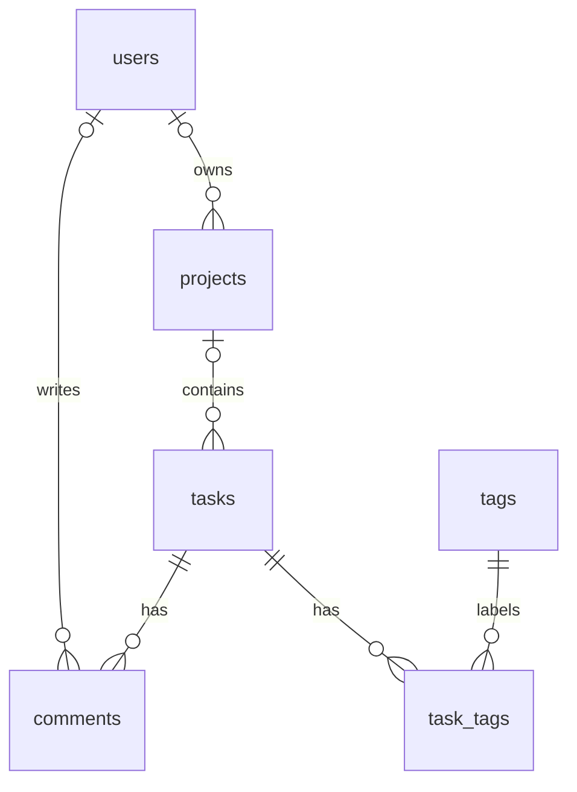

# แนวทางเรียนรู้ SQLite กับ Node.js

## โครงสร้างล่าสุด: 6 ตาราง

ไฟล์ฐานข้อมูลจริงอยู่ที่ `C:\Users\winne\Desktop\Web\SQLite\data\todo.db` เปิดด้วย DB Browser for SQLite หรือ sqlite3 CLI ได้ ส่วน `sql/import.sql` คือคำสั่งสร้างฐานข้อมูล ตัว SQLite ที่ Node.js ใช้อยู่ในโมดูล `node:sqlite`

| ตาราง     | หน้าที่และความสัมพันธ์                                               |
| --------- | -------------------------------------------------------------------- |
| users     | ผู้ใช้ 3 คน มี email ไม่ซ้ำ                                          |
| projects  | โปรเจกต์ 2 รายการ; owner_id อ้าง users.id                            |
| tasks     | งาน; project_id อ้าง projects.id และเป็น NULL ได้                    |
| comments  | ความคิดเห็น 3 รายการ; task_id อ้าง tasks.id, author_id อ้าง users.id |
| tags      | แท็ก 3 รายการ                                                        |
| task_tags | คู่ความสัมพันธ์ 4 คู่; task_id และ tag_id เป็น composite primary key |



task_tags แสดง many-to-many: งานมีหลายแท็กและแท็กใช้กับหลายงาน การลบงานจะลบ comments และ task_tags ด้วย CASCADE การลบผู้ใช้/โปรเจกต์จะใช้ SET NULL ตาม foreign key ต้องเปิด PRAGMA foreign_keys = ON ทุก connection ที่เขียนข้อมูล

รัน `npm run demo:relations` เพื่อดึงข้อมูลผ่าน Node.js และดู JOIN ของเจ้าของโปรเจกต์ ความคิดเห็นพร้อมผู้เขียน และแท็ก หน้าเว็บจัดการผู้ใช้ โปรเจกต์ งาน แท็ก และความคิดเห็น รวมถึงชุดแท็กของงาน แบบฝึก JOIN อยู่ใน `sql/practice.sql`

อัปเกรดฐานข้อมูลเดิมด้วย `npm run db:import` โดยรักษางานเดิมไว้และเพิ่ม project_id เป็น NULL ทดลองกำหนดโปรเจกต์ผ่าน UPDATE ใน practice.sql ได้ (แบบฝึก ROLLBACK ตอนจบ) ถ้า import SQL โดยตรงลงไฟล์รุ่นเดิม ให้อัปเกรดด้วยคำสั่ง Node.js นี้ก่อน ตาราง sqlite_sequence เป็นตารางภายในของ SQLite จึงไม่นับใน 6 ตาราง

## 1. เป้าหมาย

สร้างระบบจัดการโปรเจกต์ขนาดเล็กเพื่อเรียนรู้การออกแบบตาราง การนำเข้า SQL การเชื่อมฐานข้อมูลจาก Node.js และ CRUD ผ่าน REST API หลังเรียนจบควรอธิบายได้ว่าปุ่มบนหน้าเว็บทำให้ข้อมูลในฐานข้อมูลเปลี่ยนอย่างไร

## 2. SQLite คืออะไร

SQLite เป็นฐานข้อมูลเชิงสัมพันธ์ที่ฝังในโปรแกรม เก็บฐานข้อมูลลงไฟล์โดยไม่ต้องเปิดบริการฐานข้อมูลแยก เหมาะสำหรับฝึก SQL และโปรเจกต์ขนาดเล็ก ในโปรเจกต์นี้ไฟล์คือ `data/todo.db` ส่วน SQL เป็นภาษาที่ใช้สร้างและจัดการข้อมูล

เราใช้ `DatabaseSync` จาก `node:sqlite` ใน Node.js 24 API ทำงานแบบ synchronous และเวอร์ชันนี้อาจแสดง ExperimentalWarning ซึ่งไม่ใช่ผลทดสอบล้มเหลว ตัวอย่างนี้เหมาะกับการเรียนรู้ งานที่มีผู้ใช้จำนวนมากควรประเมินการบล็อก event loop และภาระการเขียนข้อมูลก่อน

แหล่งอ้างอิง: [Node.js 24 SQLite API](https://nodejs.org/download/release/v24.14.0/docs/api/sqlite.html), [SQLite overview](https://www.sqlite.org/about.html), [SQLite CLI](https://www.sqlite.org/cli.html)

## 3. เส้นทางข้อมูล

```text
Browser (public/index.html)
  → fetch /api/tasks
  → Node.js HTTP server (src/server.js)
  → prepared statement (src/db.js)
  → SQLite (data/todo.db)
  → JSON กลับไปแสดงบนหน้าเว็บ
```

Browser เรียก API ส่วน Node.js เป็นผู้เปิดไฟล์ฐานข้อมูล การปิดแล้วเปิด server ใหม่ยังอ่านข้อมูลเดิมได้

## 4. โครงสร้างตาราง tasks

| คอลัมน์    | ชนิด                              | ความหมาย                                         |
| ---------- | --------------------------------- | ------------------------------------------------ |
| id         | INTEGER PRIMARY KEY AUTOINCREMENT | รหัสงานที่ไม่ซ้ำ                                 |
| title      | TEXT NOT NULL                     | ชื่องาน 1–200 ตัวอักษรหลัง trim                  |
| completed  | INTEGER                           | 0 = ยังไม่เสร็จ, 1 = เสร็จแล้ว                   |
| created_at | TEXT                              | เวลาที่สร้าง ค่าเริ่มต้น CURRENT_TIMESTAMP (UTC) |

`CHECK` ช่วยป้องกันข้อมูลที่ผิดเงื่อนไข แม้เขียน SQL ลงฐานข้อมูลโดยตรง ใน API รับ completed เป็น boolean แล้วแปลงเป็น 0 หรือ 1; JSON ที่อ่านกลับคืนค่าตามฐานข้อมูลเป็นตัวเลข

## 5. ติดตั้งและรัน

ตรวจ `node --version` ให้เป็น 24 ขึ้นไป แล้วรันจากโฟลเดอร์โปรเจกต์:

```powershell
npm install
npm run db:import
npm start
```

เปิด `http://localhost:3000` หน้าเว็บใช้ React และ Lucide React; esbuild ใช้สร้าง bundle และ Prettier ใช้จัดรูปแบบโค้ด ส่วน server ใช้ node:sqlite เดิม

ถ้า port 3000 ถูกใช้ เปลี่ยนใน PowerShell:

```powershell
$env:PORT = '3001'
npm start
```

## 6. Import SQL ลง SQLite

### วิธี A: ผ่าน Node.js (ไม่ต้องติดตั้ง sqlite3 CLI)

```powershell
npm run db:import
```

สคริปต์อ่าน `sql/import.sql` แล้ว execute ลง `data/todo.db` ตารางสร้างด้วย `IF NOT EXISTS` และ seed ใช้ `INSERT OR IGNORE` ตาม id จึง import ซ้ำได้โดยไม่ลบงานที่เพิ่มไว้ แถว seed ที่ยังมีอยู่จะไม่ถูกเขียนทับ; ถ้าลบ seed แล้วสั่ง import แถวนั้นจะถูกเติมกลับ แต่การเปิด server ตามปกติไม่เติม seed ซ้ำ การ import นี้ไม่ใช่ระบบ migration สำหรับเปลี่ยน schema ในอนาคต

### วิธี B: sqlite3 CLI

หากติดตั้ง sqlite3 CLI แล้ว เปิดจากโฟลเดอร์โปรเจกต์:

```powershell
New-Item -ItemType Directory -Force data
sqlite3 data/todo.db
```

จากนั้นพิมพ์ใน SQLite prompt:

```text
.read sql/import.sql
.headers on
.mode column
SELECT * FROM tasks;
.quit
```

ไฟล์ SQL นี้ไม่มีคำสั่งเฉพาะ CLI จึงนำไปใช้กับเครื่องมือ SQLite อื่นได้

### วิธี C: DB Browser for SQLite

1. เลือก New Database แล้วบันทึกเป็น `data/todo.db` หรือ Open Database หากมีไฟล์แล้ว
2. เปิดแท็บ Execute SQL และเปิดไฟล์ `sql/import.sql`
3. รันคำสั่งทั้งหมด หากโปรแกรมแสดงการเปลี่ยนแปลงที่ยังไม่บันทึก ให้กด Write Changes
4. ดูตาราง tasks ที่แท็บ Browse Data

ใช้ฐานข้อมูลไฟล์เดียวกับ Node.js และปิด transaction ที่ค้างในเครื่องมือก่อนทดลองเขียนข้อมูลจากเว็บ เพื่อหลีกเลี่ยง database locked

## 7. CRUD และ prepared statement

```sql
-- Create
INSERT INTO tasks (title) VALUES ('อ่านบทเรียน');
-- Read
SELECT * FROM tasks ORDER BY id DESC;
-- Update: เปลี่ยน 1 เป็น id ที่มีจริง
UPDATE tasks SET completed = 1 WHERE id = 1;
-- Delete: เปลี่ยน 1 เป็น id ที่ต้องการลบ
DELETE FROM tasks WHERE id = 1;
```

คำสั่งข้างบนเปลี่ยนข้อมูลจริง ฝึกแบบย้อนกลับได้โดยใช้ `sql/practice.sql` ซึ่งครอบการเปลี่ยนแปลงด้วย BEGIN และ ROLLBACK

ใน Node.js ใช้ parameter binding:

```js
const statement = db.prepare("INSERT INTO tasks (title) VALUES (?)");
statement.run(title);
const rows = db.prepare("SELECT * FROM tasks ORDER BY id DESC").all();
```

`?` แยกค่าข้อมูลออกจากคำสั่ง SQL จึงไม่ควรนำข้อความที่ผู้ใช้กรอกมาต่อเป็น SQL ใช้ `all()` อ่านหลายแถว, `get()` อ่านหนึ่งแถว, `run()` เขียนข้อมูล และ `exec()` รันชุด SQL ที่เชื่อถือได้ เช่นไฟล์ import ในโปรเจกต์

## 8. REST API

| Method | Path         | Body                          | ผลลัพธ์สำเร็จ     |
| ------ | ------------ | ----------------------------- | ----------------- |
| GET    | /api/tasks   | —                             | 200: รายการงาน    |
| POST   | /api/tasks   | `{ "title": "เรียน SQLite" }` | 201: งานใหม่      |
| PATCH  | /api/tasks/4 | `{ "completed": true }`       | 200: งานหลังแก้ไข |
| DELETE | /api/tasks/4 | —                             | 200: ข้อความการลบ |

ใช้ id ที่ POST ส่งกลับแทนเลข 4 ถ้าไม่ตรงกับข้อมูลจริง ระบบตอบ 400 เมื่อ JSON หรือข้อมูลไม่ถูกต้อง, 404 เมื่อไม่พบงาน/เส้นทาง, 413 เมื่อ body ใหญ่เกินกำหนด และ 500 เมื่อเกิดข้อผิดพลาดภายใน

ตัวอย่าง PowerShell (เปิด server ไว้ในอีก Terminal):

```powershell
$task = Invoke-RestMethod -Uri http://localhost:3000/api/tasks -Method Post -ContentType 'application/json; charset=utf-8' -Body '{"title":"Learn SQLite"}'
Invoke-RestMethod -Uri http://localhost:3000/api/tasks
Invoke-RestMethod -Uri "http://localhost:3000/api/tasks/$($task.id)" -Method Patch -ContentType 'application/json' -Body '{"completed":true}'
Invoke-RestMethod -Uri "http://localhost:3000/api/tasks/$($task.id)" -Method Delete
```

## 9. ฝึกและตรวจผล

1. รัน `npm run demo` แล้วเทียบผล CREATE/READ/UPDATE/DELETE กับ `scripts/demo.js`
2. เพิ่มงานผ่านเว็บ เปิดฐานข้อมูลด้วยเครื่องมือ SQLite แล้ว SELECT ดูแถวใหม่
3. ติ๊กสถานะบนเว็บ แล้วตรวจว่า completed เปลี่ยนเป็น 1
4. หยุดและเปิด server ใหม่ ตรวจว่างานที่เพิ่มยังอยู่
5. ฝึก WHERE, ORDER BY และ GROUP BY จาก `sql/practice.sql`
6. รัน `npm test` ตรวจ CRUD, import ซ้ำ, constraint, ข้อความที่คล้าย SQL injection และ API รวมถึง input ที่ผิด

แนวทางต่อยอด: เพิ่มวันครบกำหนด ค้นหาและกรองงาน หรือเพิ่มระบบ login และสิทธิ์ผู้ใช้

## 10. ขอบเขตตัวอย่าง

server เปิดรับบนเครื่องตัวเองที่ 127.0.0.1 ไม่มี login และเหมาะกับการเรียนรู้ ส่วนฐานข้อมูลใน test และ demo อยู่ในหน่วยความจำและถูกปิดหลังใช้งาน หากต้องการฐานข้อมูลว่าง ให้เปลี่ยน seed ใน SQL และใช้ไฟล์ฐานข้อมูลใหม่; การแก้ SQL ไม่ได้เปลี่ยน schema ของไฟล์เดิมโดยอัตโนมัติ

## 11. การใช้งานระบบครบ 6 ตาราง

1. หน้า “ผู้ใช้” เพิ่ม แก้ไข หรือลบชื่อและ email (ต้องไม่ซ้ำ)
2. หน้า “โปรเจกต์” เพิ่ม/แก้ไขชื่อและเลือกเจ้าของจากผู้ใช้
3. หน้า “แท็ก” สร้างแท็กที่นำไปใช้กับหลายงานได้
4. หน้า “งาน” เพิ่ม/แก้ไขชื่อ เลือกโปรเจกต์ เปลี่ยนสถานะ หรือลบงาน
5. กด “รายละเอียด” ของงาน เลือกแท็กแล้วบันทึก เพิ่มความคิดเห็นและเลือกผู้เขียน แก้ไขหรือลบความคิดเห็นได้
6. สรุปจำนวนด้านบนแสดงข้อมูลทั้ง 6 ตาราง; task_tags เปลี่ยนตามชุดแท็กที่บันทึก

### API ของข้อมูลทั้งหมด

| Resource      | POST body                                    | PATCH body ตัวอย่าง                 |
| ------------- | -------------------------------------------- | ----------------------------------- |
| /api/users    | {"name":"Min","email":"min2@example.com"}    | {"name":"New name"}                 |
| /api/projects | {"name":"Project","owner_id":1}              | {"owner_id":null}                   |
| /api/tasks    | {"title":"Task","project_id":1}              | {"title":"Edited","completed":true} |
| /api/comments | {"task_id":1,"author_id":1,"body":"Comment"} | {"body":"Edited"}                   |
| /api/tags     | {"name":"Learning"}                          | {"name":"SQL learning"}             |

ทุก resource รองรับ GET อ่านรายการ, GET /:id อ่านหนึ่งรายการ, POST เพิ่ม, PATCH /:id แก้ไขบางฟิลด์ และ DELETE /:id ลบ รหัสตัวอย่างต้องมีอยู่จริง owner_id, project_id และ author_id เว้นว่างหรือส่ง null ได้; task_id ของความคิดเห็นต้องมีเสมอ

PUT /api/tasks/:id/tags รับ {"tag_ids":[1,2]} เพื่อแทนที่ชุดแท็กทั้งหมด; [] ใช้ล้างแท็ก ใช้ transaction และตัดรหัสซ้ำก่อนเพิ่ม ส่วน GET /api/task-tags อ่านคู่ความสัมพันธ์ในตารางเชื่อม ไม่ต้องสร้างคู่ผ่านฟอร์มแยก

รายการงานมี project_name และ tags; รายการโปรเจกต์มี owner_name; รายการความคิดเห็นมี author_name จาก JOIN ส่วน GET รายการเดียวคืนแถวข้อมูลของตาราง รหัสอ้างอิงผิดตอบ 400 ข้อมูล UNIQUE ซ้ำตอบ 409

การลบงานลบความคิดเห็นและคู่แท็กด้วย CASCADE การลบแท็กลบคู่แท็ก การลบโปรเจกต์ทำให้งาน project_id เป็น NULL การลบผู้ใช้ทำให้ owner_id/author_id เป็น NULL หน้าเว็บแจ้งผลกระทบและให้ยืนยันก่อนลบ

### การเปิดฐานข้อมูลและข้อมูลตัวอย่าง

ครั้งแรกหรือเมื่ออัปเกรดฐานข้อมูลรุ่นเก่าที่ไม่มี task_tags จะ import schema กับ seed ให้ การเปิด server ครั้งถัดไปไม่เติม seed กลับ จึงรักษาผลการลบไว้ หากต้องการเติมตัวอย่างกลับโดยตั้งใจ ให้รัน npm run db:import งานรุ่นเดิมคงอยู่และเลือกโปรเจกต์ให้ได้จากหน้าเว็บ

### ไฟล์หน้าเว็บ

- public/index.html: หน้าหลักที่ mount React
- frontend/app.jsx: React UI, fetch, Dashboard, แท็บ, รายละเอียดงาน และ dialog
- public/style.css: รูปแบบหน้าเว็บและหน้าจอขนาดเล็ก
- public/app.js: bundle ที่สร้างด้วย npm run build (แก้ต้นฉบับใน frontend/app.jsx)
- src/server.js: API, validation และ SQL สำหรับ resource ทั้งหมด
- test/project.test.js: workflow ข้ามตาราง CASCADE/SET NULL และการเปิดฐานข้อมูลซ้ำ

## 12. Dashboard และหน้าจอ React

Dashboard แสดงจำนวนทั้ง 6 ตารางแยกการ์ด พร้อมจำนวนงานเสร็จแล้วและคงเหลือ แท็บงาน/โปรเจกต์/ผู้ใช้/แท็กมีไอคอน Lucide React และจำนวนรายการ ค้นหาชื่อได้ในแต่ละแท็บ กดเพิ่มหรือแก้ไขจะเปิด dialog ส่วนลบเปิด dialog พร้อมชื่อรายการและผลกระทบ ยกเลิกหรือ Esc ปิดได้ ขณะบันทึกระบบป้องกันการส่งซ้ำ ข้อผิดพลาดจะแสดงใน dialog

npm start จะ build React ให้อัตโนมัติก่อนเปิด server หลังแก้ frontend/app.jsx ให้รัน npm run build แล้วรีเฟรช ใช้ npm run test:ui เพื่อตรวจหน้าเว็บด้วย Microsoft Edge แบบ headless บนฐานข้อมูลในหน่วยความจำ แยกจากข้อมูลจริง ภาพตรวจหน้าจออยู่ใน artifacts/
